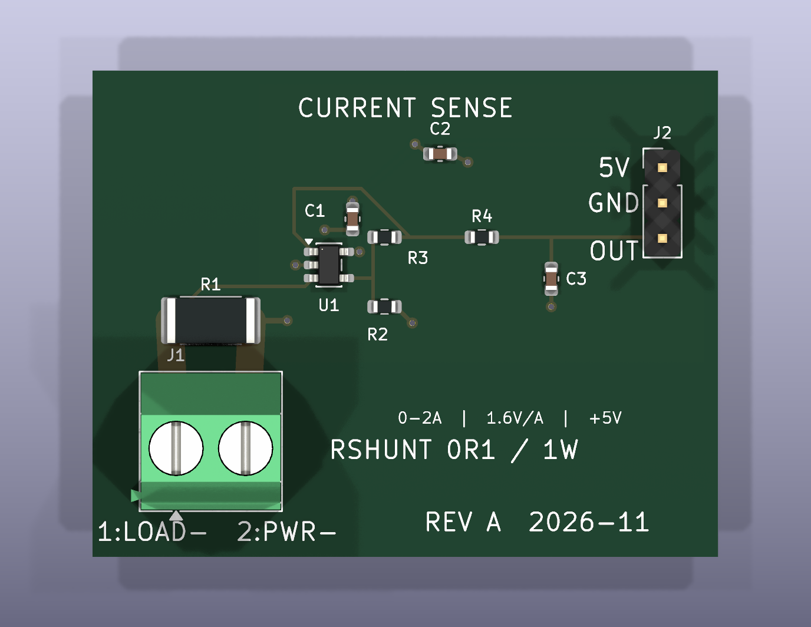

# Classic Current Sense

经典低端电流检测电路：使用 **0.1 Ω 采样电阻 + OPA333 运放**，检测 0～2 A 单向直流电流。包含完整 KiCad 10 原理图、已布线的双层 PCB、制造文件及检查报告。

| 参数 | 数值 |
| --- | --- |
| 运放供电 | +5 V |
| 标称增益 | 16 |
| 理想输出 | 1.6 V/A；2 A 对应 3.2 V |
| 采样电阻 | 0.1 Ω，1 W，1%，2512 |
| PCB 尺寸 | 45 × 35 mm，双层，1.6 mm 板厚 |
| 主电流走线 | 2 mm 宽 |
| 输出滤波 | 1 kΩ + 100 nF，RC 截止频率约 1.59 kHz |

## 打开项目

使用 KiCad 10 打开 [Classic_Current_Sense.kicad_pro](Classic_Current_Sense.kicad_pro)。

- [原理图](Classic_Current_Sense.kicad_sch)
- [PCB](Classic_Current_Sense.kicad_pcb)
- [制造文件：Gerber 与钻孔](manufacturing/)
- [物料表](BOM.csv)
- [顶层贴片坐标](placement.csv)
- [详细接线、布局与使用说明](使用说明.md)

J1-1 接负载负极，J1-2 接负载电源负极；电源正极直接接负载正极。J2 的 1/2/3 脚分别为 +5 V、GND、VOUT。

## 验证

2026-11-16，KiCad 10.0.8：

- [ERC](ERC_final.json)：0 违规。
- [DRC](DRC_final.rpt)：0 错误、0 警告、0 未连接焊盘，包含原理图一致性检查。

以上是设计文件检查，尚未进行打样、实物温升和精度测试。近零电流时存在输出摆幅与失调限制；3.2 V 为满量程标称值，连接 3.3 V ADC 时应考虑容差、过流和输入保护。具体工艺与器件选型见使用说明。

## 设计工具

本工程通过本地部署的 [KiCAD-MCP-Server](https://github.com/mixelpixx/KiCAD-MCP-Server) v2.9.0 与 KiCad 10.0.8 创建。PCB 编辑使用实时 IPC，使布局、走线和铺铜变化直接显示在 KiCad 编辑器中。

KiCAD-MCP-Server 是独立的上游项目。本仓库存放本电流检测工程；本地安装程序、Python 环境及个人 Codex 配置不在仓库中。
